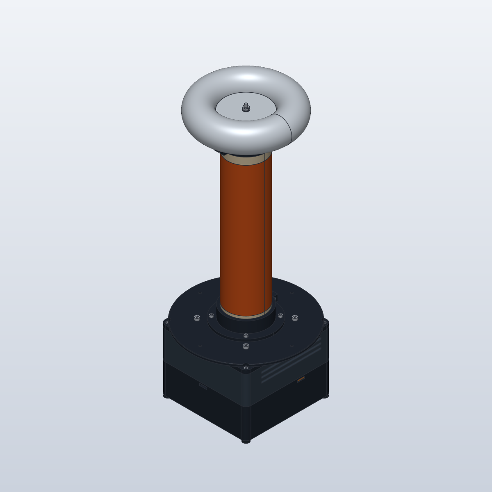
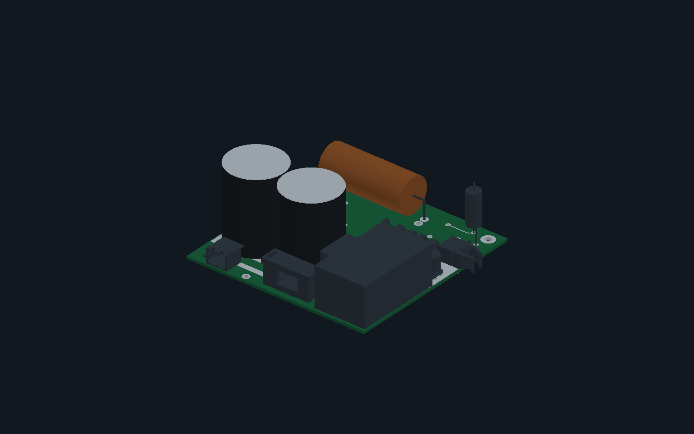

# ARCSTRIKE

A **dual-resonant solid-state Tesla coil (DRSSTC)** project combining KiCad
electronics, resonator calculations, and a parametric enclosure with a unified
lid and resonator deck.

<p align="center">
  
</p>

<p align="center"><em>Enclosure and resonator overview. The current CAD incorporates the unified lid and deck.</em></p>

<p align="center">
  
</p>

<p align="center"><em>Assembled PCB — explore the interactive view in the project notebook.</em></p>

**Status:** assembly prototype. Physical fits, thermal behavior, and electrical
insulation still require validation. The primary wire holder remains pending.

## Quick start

| Task | File |
| --- | --- |
| Edit the electronics | [KiCad project](hardware/pcb/oneTesla.kicad_pro) |
| Print the enclosure | [STLs and quantities](mechanical/print/) |
| Assemble the enclosure | [Assembly guide](mechanical/README.md) · [Hardware BOM](mechanical/exports/hardware-BOM.csv) |
| Open the assembly in CAD | [STEP](mechanical/exports/ASSEMBLY.step) · [SolidCraft](mechanical/ASSEMBLY.sc) |
| Review the calculations | [Coil design](docs/design/COILS.md) |
| Explore the offline documentation | [Project notebook](docs/project/PROJECT-DRSSTC.html) |
| Inspect the PCB exports | [Gerbers, reports, and STEP](hardware/pcb/exports/) |

## Repository structure

```text
hardware/pcb/    KiCad project, local libraries, and PCB exports
mechanical/      Current enclosure sources, print files, assembly, and checks
docs/            Calculations, project notebook, and technical references
scripts/         PCB and documentation tools
```

The repository contains the current project. Earlier revisions are available
through Git history. Exported files stay alongside their sources in
`hardware/pcb/exports/` and `mechanical/exports/`. Printable STLs live in
`mechanical/print/`, with quantities included in their filenames.

## Reproduce the project

Run commands from the repository root:

```sh
# Recalculate the resonator (Python 3)
python3 -B scripts/calculate_resonator.py

# Rebuild the current enclosure (uv and CadQuery)
uv run --with cadquery python mechanical/build.py

# Validate all printable meshes
python3 -B mechanical/verify_stls.py

# Build the notebook and its offline ZIP (Python 3 and Node.js)
python3 -B scripts/build_project_document.py
```

Generated ZIPs and temporary results go to `output/`, which is ignored by Git.
Rebuilding CAD updates the exported files; review the reports and diff before
committing. The existing Gerbers represent the export documented in the
[PCB export notes](hardware/pcb/exports/README.md).

## Documentation

- [Electronics and KiCad libraries](hardware/pcb/README.md)
- [Enclosure assembly and printing](mechanical/README.md)
- [Technical documentation index](docs/README.md)
- [Tools and validation commands](scripts/README.md)
- [Maintenance conventions](CONTRIBUTING.md)
